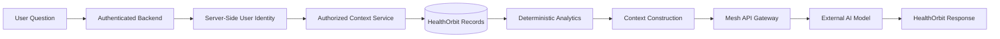
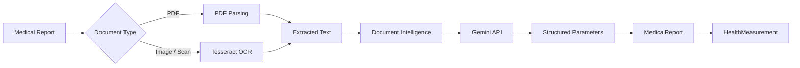
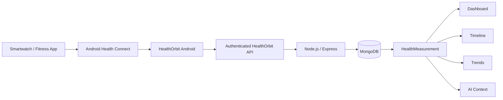
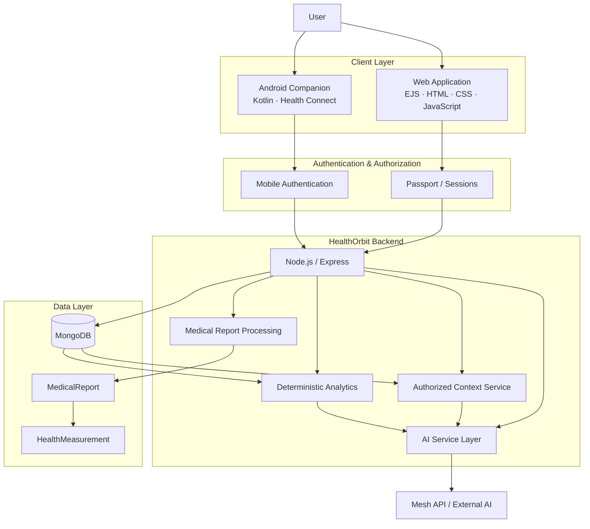

<div align="center">


<br/>

[](https://healthorbit.onrender.com/)
[](https://github.com/Its-AtharvDeshmukh/HealthOrbit-Android)


<br/><br/>

### One health context. One continuous story.

**Reports · Measurements · Timeline · Trends · Wearables · AI**

</div>

---

## 🩺 About HealthOrbit

**HealthOrbit** is an integrated personal health-information platform designed to bring fragmented health information into one structured, secure, and understandable environment.

It connects **medical reports, health measurements, medicines, symptoms, wearable data, nutrition, lifestyle records, insurance information, emergency information, and authorized family access** through one HealthOrbit account.

The platform combines **medical-document processing, OCR, deterministic health analytics, longitudinal records, Android Health Connect integration, and context-aware AI assistance**.

> **HealthOrbit is an informational and organizational system. It does not diagnose disease, prescribe medication, or replace qualified healthcare professionals.**

---

## ⚡ HealthOrbit at a Glance

```text
Medical Reports ───────┐
Wearable Data ─────────┤
Medicines ─────────────┤
Symptoms ──────────────┤
Nutrition ─────────────┤
Hydration ─────────────┤
Lifestyle ─────────────┤
Profile & Family ──────┤
                       ▼
              AUTHORIZED HEALTH CONTEXT
                       │
         ┌─────────────┼─────────────┐
         ▼             ▼             ▼
     Timeline        Trends       Dashboard
         │             │             │
         └─────────────┴─────────────┘
                       ▼
             Context-Aware AI
```

---

## ✨ Core Features

<table>
<tr>
<td width="50%" valign="top">

### 🔐 Authentication & Authorization
- Registration and login
- Session-based web authentication
- Google authentication support
- Password hashing
- Ownership and permission checks
- Mobile API authentication

### 📄 Medical Reports & OCR
- PDF and image uploads
- Tesseract OCR
- PDF text extraction
- Structured report parameters
- Report correction workflow
- HealthMeasurement synchronization

### 🕒 Timeline & Trends
- Chronological health history
- Metric comparisons
- Average / minimum / maximum
- Reference-range evaluation
- Deterministic trend analysis

### 💊 Medicines & Symptoms
- Medicine schedules
- Medicine logs
- Symptom records
- Longitudinal health context

</td>
<td width="50%" valign="top">

### 👤 Profile, Privacy & Family
- Health profile
- Allergies and conditions
- Emergency contacts
- Privacy preferences
- Permission-based family access

### 🤖 AI Medical Analysis
- Medical-report explanations
- Context-aware health questions
- Doctor consultation preparation
- Conversation history
- Authorized backend context only

### ⌚ Wearable / Health Connect
- Android Health Connect
- HealthOrbit Android companion
- Authenticated wearable sync
- Source-aware measurements

### 🥗 Lifestyle, Emergency & Insurance
- Meals and hydration
- Lifestyle habits
- Wellness goals
- Emergency functions
- Insurance records

</td>
</tr>
</table>

---

## 🛠️ Technology Stack

<div align="center">

### Web & Backend


### Android & Mobile


### Infrastructure & Tools


</div>

<p align="center">
<b>EJS · Mongoose · Passport.js · Express Session · bcrypt · Multer · Cloudinary · Tesseract.js · pdf-parse · Gemini API · Mesh API · Android Health Connect · Jetpack Compose · WorkManager</b>
</p>

---

## 🧠 Context-Aware AI Architecture

HealthOrbit **does not train or host its own machine-learning model**.

The backend gathers authorized HealthOrbit records, performs deterministic calculations, constructs context, and then communicates with an external AI model through the Mesh API gateway.



### Medical Document Intelligence



---

## ⌚ Wearable & Health Connect

HealthOrbit does **not** directly connect the website to individual smartwatch brands.



<div align="center">

[](https://github.com/Its-AtharvDeshmukh/HealthOrbit-Android)

</div>

The Android application is a **client of the existing HealthOrbit backend**. It does not create a second backend or duplicate database.

---

## 🏗️ System Architecture



---

## 🧩 Modules

| # | Module | Purpose |
|---:|---|---|
| 01 | 🔐 Authentication & Authorization | Secure access and permission control |
| 02 | 👤 Profile & Privacy | Personal health profile and privacy information |
| 03 | 🏥 Insurance Management | Insurance policies and related records |
| 04 | 🚨 Emergency & SOS | Emergency health information and support functions |
| 05 | 🤖 AI Medical Analysis & Health Assistant | Context-aware informational assistance |
| 06 | ⌚ Wearable / Health Connect | User-authorized wearable synchronization |
| 07 | 📄 Medical Reports & OCR | Medical-document processing and structured extraction |
| 08 | 🕒 Health Timeline | Chronological health-information organization |
| 09 | 📈 Health Trends | Deterministic longitudinal analytics |
| 10 | 💊 Medicines & Symptoms | Medicine and symptom management |
| 11 | 🥗 Nutrition, Hydration & Lifestyle | Lifestyle and wellness records |
| 12 | 👨‍👩‍👧 Family & Authorized Access | Permission-based family health sharing |

---

## 📂 Repository Structure

```text
HealthOrbit/
├── config/          # Application and service configuration
├── controllers/     # Request handlers and module controllers
├── middleware/      # Authentication and authorization middleware
├── models/          # MongoDB / Mongoose models
├── public/          # CSS, JavaScript and static assets
├── routes/          # Express route modules
├── services/        # AI, OCR, timeline, trends and other services
├── views/           # EJS pages and partials
├── app.js
├── server.js
├── package.json
└── README.md
```

---

## ⚙️ Run Locally

### 1. Clone

```bash
git clone https://github.com/Its-AtharvDeshmukh/HealthOrbit.git
cd HealthOrbit
```

### 2. Install dependencies

```bash
npm install
```

### 3. Configure environment variables

```env
MONGODB_URI=
SESSION_SECRET=

GOOGLE_CLIENT_ID=
GOOGLE_CLIENT_SECRET=

GEMINI_API_KEY=
MESH_API_KEY=

CLOUDINARY_CLOUD_NAME=
CLOUDINARY_API_KEY=
CLOUDINARY_API_SECRET=
```

> Never commit real API keys, private tokens, passwords, or production secrets.

### 4. Start

```bash
node server.js
```

Development:

```bash
nodemon server.js
```

---

## 🔒 Privacy & Safety

- User identity is derived on the backend.
- Private health records require authentication and authorization.
- Frontend-supplied user IDs are not trusted for private record ownership.
- AI receives only authorized context.
- Stored medical facts and AI-generated explanations remain conceptually separate.
- HealthOrbit does not claim clinical validation.
- HealthOrbit does not diagnose disease.
- HealthOrbit does not prescribe medication.
- HealthOrbit does not replace healthcare professionals.

---

## 🔬 Current Scope

<details>
<summary><b>Implemented / actively developed</b></summary>

<br/>

- Authentication and profile foundations
- Medical-report upload and document processing
- OCR and structured extraction
- Normalized HealthMeasurement records
- Health Timeline
- Health Trends and deterministic analytics
- Medicines and Symptoms
- Nutrition, Hydration and Lifestyle
- Insurance
- Emergency functions
- Family / authorized access
- AI Medical Analysis and conversational assistance
- Android Health Connect companion architecture

</details>

<details>
<summary><b>Future expansion</b></summary>

<br/>

- Wider device interoperability
- Hospital / EHR interoperability
- HL7 FHIR-based exchange
- Voice and multilingual assistance
- Stronger consent and auditing
- Additional medical-document types
- Formally evaluated predictive techniques where appropriate

</details>

---

## 🎓 Academic Project

| | |
|---|---|
| **Project** | HealthOrbit |
| **Department** | Computer Engineering |
| **College** | Smt. Radhikatai Pandav College of Engineering, Nagpur |
| **University** | Rashtrasant Tukadoji Maharaj Nagpur University |
| **Academic Year** | 2026–2027 |
| **Guide** | Prof. K. R. Sarode |

### Team

<div align="center">

**Atharv Deshmukh · Ansh Shahane · Sujal Arse · Vansh Sakhare**

</div>

---

## ⚠️ Medical Disclaimer

> HealthOrbit is a personal health-information management and assistance platform.
>
> Information generated or explained through AI services is intended for **informational and organizational purposes only**.
>
> **HealthOrbit does not provide medical diagnosis, prescriptions, treatment recommendations, or emergency medical advice.**
>
> Always consult a qualified healthcare professional for medical decisions.

---

<div align="center">


### Build a clearer picture of your health information.

[](https://healthorbit.onrender.com/)

</div>
