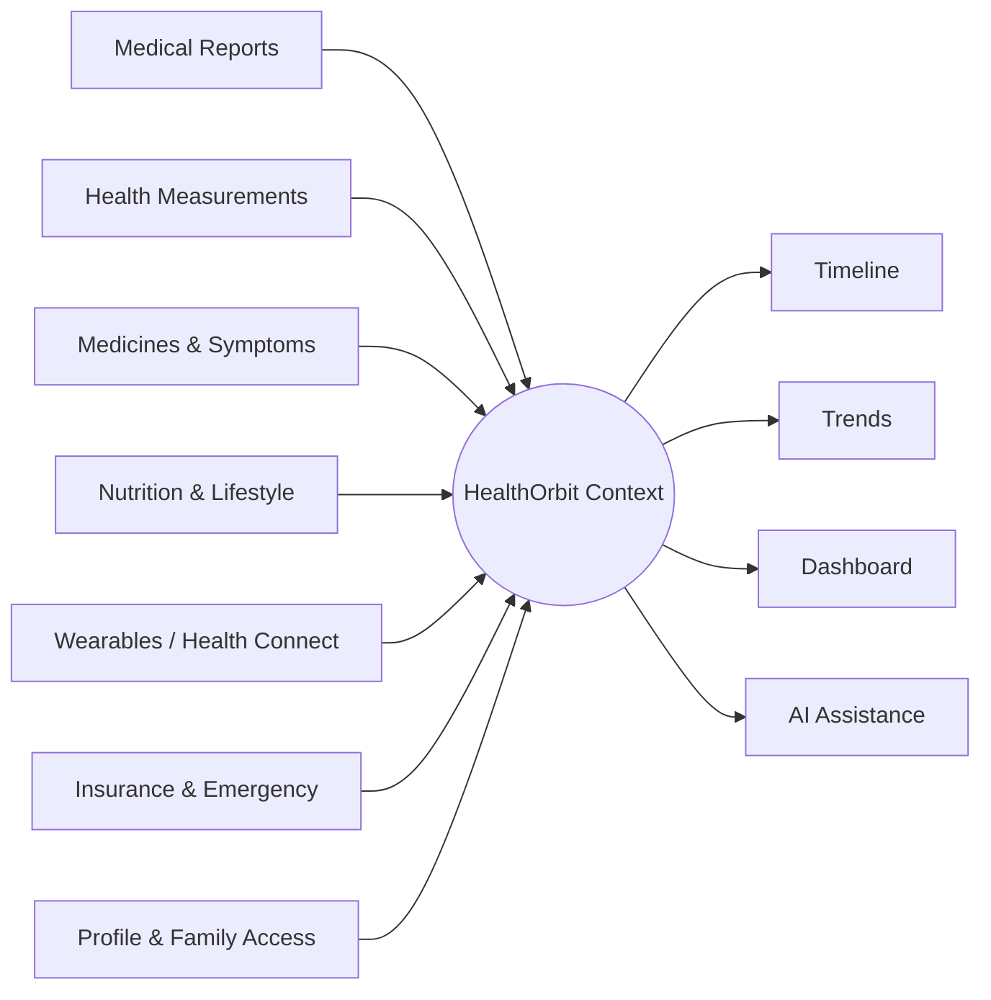
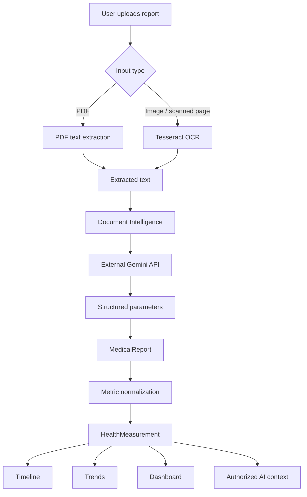
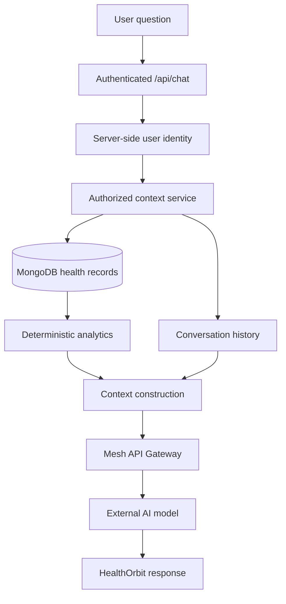
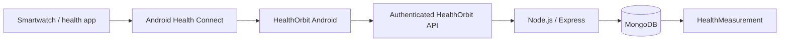
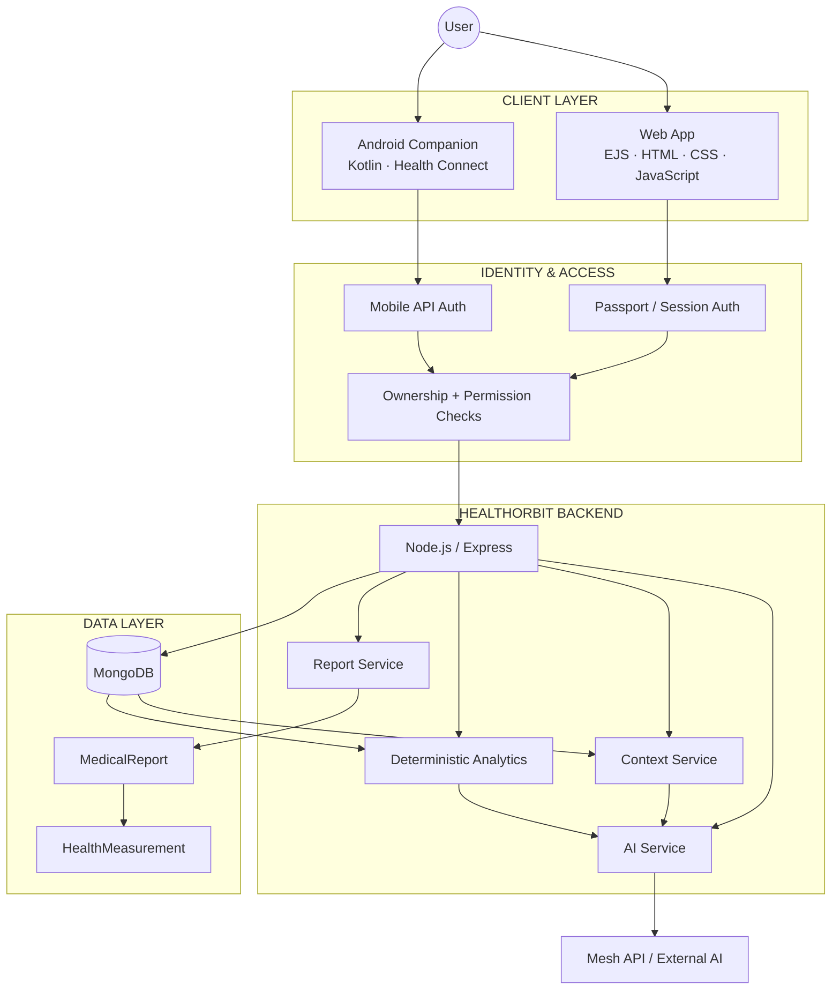

<div align="center">


<br/>


<br/><br/>

[](https://healthorbit.onrender.com/)
[](https://github.com/Its-AtharvDeshmukh/HealthOrbit-Android)
[](#academic-project)

<br/>

**Medical reports · health measurements · timeline · trends · wearables · context-aware AI**

</div>

---

## HealthOrbit

HealthOrbit is an **integrated digital health information platform** built to organize personal health information that would otherwise remain scattered across reports, measurements, medicines, symptoms, wearable records, nutrition, insurance, emergency information, and family-access workflows.

Instead of treating each source as a separate feature, HealthOrbit connects them through one authenticated account and one longitudinal health context.

> **HealthOrbit is an information-management and assistance platform. It does not diagnose disease, prescribe medication, or replace qualified healthcare professionals.**

---

## The Product in One View



HealthOrbit is designed around one idea:

> **Preserve the original health information, normalize what can be measured, keep its source and time, and only then build useful context around it.**

---

## Product Pillars

<table>
<tr>
<td width="50%" valign="top">

### 🧾 Understand documents

Medical reports can be uploaded and processed through PDF extraction or OCR.

The resulting text is converted into structured report parameters, while the original report remains the source of truth.

**Includes**
- PDF and image uploads
- Tesseract OCR
- PDF text extraction
- report lifecycle handling
- structured parameter extraction
- source-linked HealthMeasurement records

</td>
<td width="50%" valign="top">

### 🕒 Preserve the health story

HealthOrbit organizes supported health information chronologically instead of reducing everything to a single dashboard snapshot.

**Includes**
- longitudinal timeline
- report observations
- health measurements
- medicines and medicine logs
- symptoms
- recorded source and timestamp

</td>
</tr>

<tr>
<td width="50%" valign="top">

### 📈 Explain change without pretending to predict

Trends are based on deterministic calculations over stored measurements.

HealthOrbit does not claim a custom predictive model where one does not exist.

**Includes**
- current vs previous values
- period comparisons
- average / minimum / maximum
- reference-range evaluation
- deterministic deviations
- source-aware history

</td>
<td width="50%" valign="top">

### 🤖 Add AI only after context is authorized

The backend decides which user-owned information can be supplied as context.

HealthOrbit then uses external AI services for explanation and conversational assistance.

**Not used**
- no locally trained ML model
- no vector-database RAG pipeline
- no autonomous diagnosis
- no prescription generation

</td>
</tr>
</table>

---

## Experience Map

<div align="center">

| 01 | 02 | 03 | 04 |
|---|---|---|---|
| **Capture** | **Normalize** | **Connect** | **Explain** |
| Reports, logs, wearables | Structured measurements | Timeline + health context | Trends + AI assistance |

</div>

---

## Core Modules

| # | Module | Role inside HealthOrbit |
|---:|---|---|
| 01 | **Authentication & Authorization** | Secure access, sessions, mobile authentication, ownership and permission checks |
| 02 | **Profile & Privacy** | Personal health profile, privacy preferences and emergency details |
| 03 | **Insurance Management** | User-owned insurance information and related records |
| 04 | **Emergency & SOS** | Emergency health information and SOS-related workflows |
| 05 | **AI Medical Analysis & Health Assistant** | Context-aware informational assistance using authorized health context |
| 06 | **Wearable / Health Connect** | Android Health Connect synchronization through the companion app |
| 07 | **Medical Reports & OCR** | Upload, extraction, structured parameters and report-derived measurements |
| 08 | **Longitudinal Health Timeline** | Chronological organization of supported health events |
| 09 | **Health Trends** | Deterministic longitudinal measurement analytics |
| 10 | **Medicines & Symptoms** | Medicine schedules, logs and symptom records |
| 11 | **Nutrition, Hydration & Lifestyle** | Meals, hydration, habits and wellness goals |
| 12 | **Family & Authorized Access** | Permission-based sharing of selected health information |

---

## Technology Orbit

<div align="center">

### Web Platform


### Android Companion


### Engineering Tools


<br/>

`EJS` · `Mongoose` · `Passport.js` · `Express Session` · `bcrypt` · `Multer` · `Cloudinary` · `Tesseract.js` · `pdf-parse` · `Gemini API` · `Mesh API` · `Health Connect` · `Jetpack Compose` · `WorkManager`

</div>

---

## Medical Report Pipeline



### Why the separation matters

`MedicalReport` preserves document-oriented information.

`HealthMeasurement` represents normalized numerical observations that can participate in longitudinal analysis.

This allows HealthOrbit to preserve **source, date, unit and record ownership** instead of flattening every report into anonymous values.

---

## Context-Aware AI

HealthOrbit does **not train or host its own machine-learning model**.

For conversational assistance, the application follows a server-controlled context pipeline:



The goal is to make recorded health information easier to understand while maintaining a clear boundary between **stored facts** and **AI-generated explanations**.

---

## Wearable Architecture

The web application does not directly connect to individual smartwatch brands.

The wearable path is built around the Android ecosystem:



From `HealthMeasurement`, supported wearable observations can become available to the dashboard, timeline, trends and authorized context.

<div align="center">

[](https://github.com/Its-AtharvDeshmukh/HealthOrbit-Android)

</div>

> The Android project is a client of the existing HealthOrbit backend. It does not create a second Node.js backend or duplicate MongoDB database.

---

## System Architecture



---

## Repository Layout

```text
HealthOrbit/
├── config/          application and service configuration
├── controllers/     route handlers and module controllers
├── middleware/      authentication and request middleware
├── models/          Mongoose domain models
├── public/          CSS, browser JavaScript and static assets
├── routes/          Express routes
├── services/        OCR, document, health, analytics and AI services
├── views/           EJS views and partials
├── app.js
├── server.js
├── package.json
└── README.md
```

No additional README asset folder is required.

---

## Run Locally

```bash
git clone https://github.com/Its-AtharvDeshmukh/HealthOrbit.git
cd HealthOrbit
npm install
```

Create your local environment configuration:

```env
MONGODB_URI=
SESSION_SECRET=

GOOGLE_CLIENT_ID=
GOOGLE_CLIENT_SECRET=

GEMINI_API_KEY=
MESH_API_KEY=

CLOUDINARY_CLOUD_NAME=
CLOUDINARY_API_KEY=
CLOUDINARY_API_SECRET=
```

> Never commit production secrets, API keys, passwords or private tokens.

Start the app:

```bash
node server.js
```

For development:

```bash
nodemon server.js
```

---

## Privacy & Safety by Design

<table>
<tr>
<td width="50%" valign="top">

### Identity & ownership

- user identity is derived on the backend
- private records require authentication
- record ownership is verified server-side
- frontend-supplied user IDs are not trusted for private data

</td>
<td width="50%" valign="top">

### AI boundaries

- only authorized context is supplied
- stored facts remain separate from generated explanations
- no diagnosis claim
- no prescription claim
- no claim of clinical validation

</td>
</tr>
</table>

---

## Current Scope

<details>
<summary><b>Implemented / actively developed</b></summary>

<br/>

- authentication and profile foundations
- medical-report upload and processing
- OCR and structured document extraction
- normalized HealthMeasurement records
- longitudinal health timeline
- deterministic health trends
- medicines and symptoms
- nutrition, hydration and lifestyle
- insurance
- emergency functions
- family / authorized access
- AI Medical Analysis and conversational assistance
- Android Health Connect companion architecture

</details>

<details>
<summary><b>Future expansion</b></summary>

<br/>

- broader wearable interoperability
- hospital / EHR interoperability
- HL7 FHIR-based exchange
- voice interaction
- multilingual assistance
- stronger consent and auditing
- additional medical-document types
- formally evaluated predictive techniques where appropriate

</details>

---

## Academic Project

<table>
<tr>
<td><b>Project</b></td>
<td>HealthOrbit</td>
</tr>
<tr>
<td><b>Department</b></td>
<td>Computer Engineering</td>
</tr>
<tr>
<td><b>College</b></td>
<td>Smt. Radhikatai Pandav College of Engineering, Nagpur</td>
</tr>
<tr>
<td><b>University</b></td>
<td>Rashtrasant Tukadoji Maharaj Nagpur University</td>
</tr>
<tr>
<td><b>Academic Year</b></td>
<td>2026–2027</td>
</tr>
</table>

### Team

<div align="center">

**Atharv Deshmukh · Ansh Shahane · Sujal Arse · Vansh Sakhare**

</div>

---

## Medical Disclaimer

> HealthOrbit is intended for personal health-information management and informational assistance.
>
> AI-generated content must not be treated as medical diagnosis, prescriptions, treatment recommendations, or emergency medical advice.
>
> Medical decisions should be made with a qualified healthcare professional.

---

<div align="center">


[](https://healthorbit.onrender.com/)

</div>
