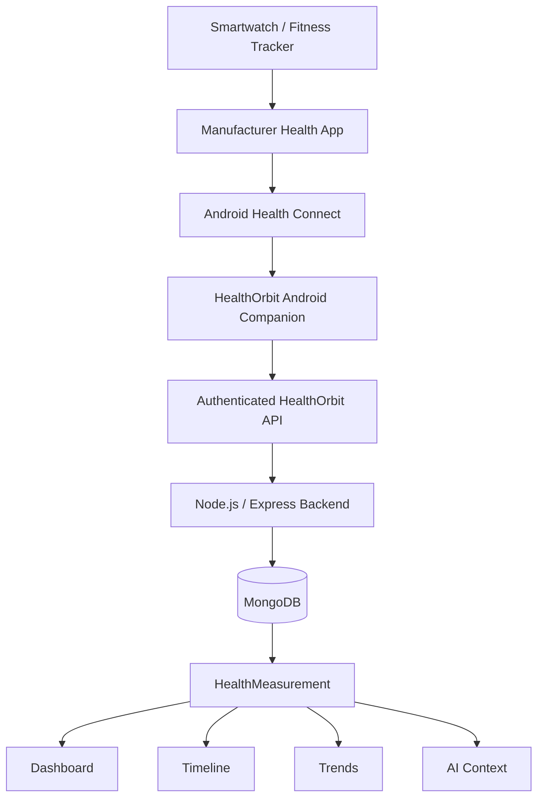
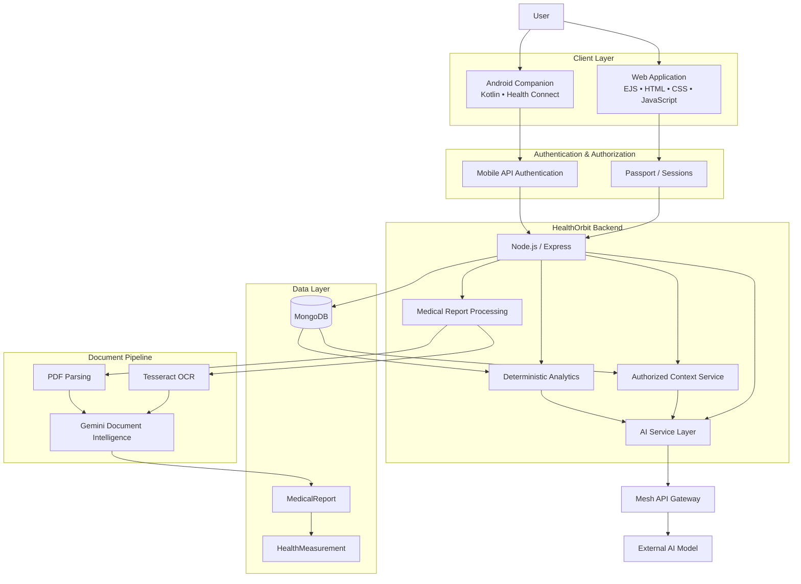

Absolutely. Here is the **entire README.md in one single copy-ready block** so you can directly replace your existing `README.md`.

```markdown
<div align="center">

# 🩺 HealthOrbit

### An Integrated Digital Health Information Platform  
### with a Framework for Context-Aware AI Assistance


<br/>

[](https://nodejs.org/)
[](https://expressjs.com/)
[](https://www.mongodb.com/)
[](https://developer.android.com/health-and-fitness/guides/health-connect)
[](https://kotlinlang.org/)

[](https://healthorbit.onrender.com/)
[](https://github.com/Its-AtharvDeshmukh/HealthOrbit-Android)

</div>

---

## 🌍 What is HealthOrbit?

**HealthOrbit** is an integrated personal health information platform designed to bring fragmented health information into one structured and accessible environment.

Personal health information is often distributed across:

- laboratory reports
- prescriptions
- medicines
- symptoms
- wearable measurements
- nutrition and lifestyle records
- insurance information
- emergency information
- historical health records

HealthOrbit brings these different sources together and helps users **organize, review, compare, and understand their own recorded health information**.

The system combines document processing, longitudinal health records, deterministic analytics, wearable integration, and context-aware AI assistance while maintaining clear privacy and medical-safety boundaries.

> **HealthOrbit is an informational and organizational platform. It does not diagnose diseases, prescribe medication, or replace qualified healthcare professionals.**

---

## ✨ Core Idea

```text
COLLECT
   ↓
UNDERSTAND
   ↓
CONNECT
   ↓
ANALYZE
   ↓
EXPLAIN
```

HealthOrbit converts disconnected health information into a structured personal health context.

```text
Medical Reports ───────┐
Wearable Data ─────────┤
Medicines ─────────────┤
Symptoms ──────────────┤
Nutrition ─────────────┤
Hydration ─────────────┤
Lifestyle ─────────────┤
Profile Information ───┤
                       ↓
                HEALTHORBIT CONTEXT
                       ↓
          Timeline • Trends • Analytics
                       ↓
             Context-Aware Assistance
```

---

# 🚀 Main Features

<table>
<tr>
<td width="50%">

### 🔐 Authentication & Authorization

- User registration and login
- Session-based web authentication
- Google authentication support
- Password hashing
- Server-side user identity
- Ownership and permission checks
- Mobile API authentication

</td>
<td width="50%">

### 👤 Profile & Privacy

- Personal profile information
- Health-related profile details
- Medical conditions
- Allergies
- Emergency contacts
- Privacy preferences
- Account-level health context

</td>
</tr>

<tr>
<td>

### 📄 Medical Reports

- Medical document upload
- PDF and image processing
- Report lifecycle management
- Secure report access
- Report correction
- Structured health parameters
- Source-linked measurements

</td>
<td>

### 🔎 OCR & Document Intelligence

- `Tesseract.js` OCR
- `pdf-parse`
- Medical text extraction
- Structured parameter extraction
- Gemini-based document intelligence
- Metric normalization
- HealthMeasurement synchronization

</td>
</tr>

<tr>
<td>

### 🕒 Longitudinal Health Timeline

- Medical reports
- Health measurements
- Medicines
- Medicine logs
- Symptoms
- Chronological health events
- Source-aware historical records

</td>
<td>

### 📈 Health Trends

- Historical metric visualization
- Current vs previous comparison
- Average / minimum / maximum values
- Period-based comparison
- Reference-range evaluation
- Deterministic deviation analysis

</td>
</tr>

<tr>
<td>

### 💊 Medicines & Symptoms

- Active medicines
- Dosage and schedules
- Medicine logs
- Symptom records
- Manual symptom tracking
- Longitudinal health integration

</td>
<td>

### 🥗 Nutrition, Hydration & Lifestyle

- Meal records
- Hydration tracking
- Lifestyle habits
- Wellness goals
- Daily wellness information
- Structured lifestyle records

</td>
</tr>

<tr>
<td>

### 🚨 Emergency & SOS

- Emergency profile
- Emergency contacts
- SOS-related functionality
- Donor preferences
- Emergency health information
- Privacy-controlled access design

</td>
<td>

### 🏥 Insurance Management

- Insurance policies
- Policy information
- Claims-related records
- Digital insurance information
- User-owned insurance records

</td>
</tr>

<tr>
<td>

### 👨‍👩‍👧 Family & Authorized Access

- Family relationships
- Permission-based access
- Selected health-information sharing
- Owner-controlled permissions
- Separate user identities

</td>
<td>

### 🤖 AI Medical Analysis & Health Assistant

- Health-information explanations
- Medical-report summaries
- Context-aware questions
- Doctor consultation preparation
- Conversation history
- Authorized HealthOrbit context

</td>
</tr>
</table>

---

# 🧠 Context-Aware AI Architecture

HealthOrbit does **not train or host its own Machine Learning model**.

It uses external AI services through controlled backend workflows.

## Conversational Assistant

```mermaid
flowchart LR
    A[User Question] --> B[Authenticated Backend]
    B --> C[Server-Side User Identity]
    C --> D[Authorized Context Service]
    D --> E[Health Records]
    E --> F[Deterministic Analytics]
    F --> G[Context Construction]
    G --> H[Mesh API Gateway]
    H --> I[External AI Model]
    I --> J[HealthOrbit Response]
```



The conversational architecture follows:

```text
Browser
   ↓
/api/chat
   ↓
Authenticated HealthOrbit Backend
   ↓
Authorized Health Context
   ↓
Deterministic Analytics
   ↓
Conversation Context
   ↓
Mesh API Gateway
   ↓
External AI Model
```

## Medical Document Intelligence

Document analysis is kept separate from conversational AI.

```text
Medical Report
      ↓
PDF Parsing / OCR
      ↓
Extracted Text
      ↓
Document Intelligence
      ↓
Gemini API
      ↓
Structured Parameters
      ↓
MedicalReport
      ↓
HealthMeasurement
```

This separation allows HealthOrbit to change document-analysis providers without replacing the conversational architecture.

---

# ⌚ Wearable & Health Connect Architecture

HealthOrbit does **not directly connect the website to individual smartwatch brands**.

Wearable information is synchronized through the Android ecosystem.



## Android Companion Repository

📱 **HealthOrbit Android**

https://github.com/Its-AtharvDeshmukh/HealthOrbit-Android

The Android application is a **client of the existing HealthOrbit backend**.

It does not create:

- another MongoDB database
- another Node.js backend
- duplicate HealthOrbit accounts
- direct mobile database access

---

# 🏗️ System Architecture



---

# 🧩 HealthOrbit Modules

| No. | Module | Purpose |
|---:|---|---|
| 01 | 🔐 Authentication & Authorization | Secure access and permission control |
| 02 | 👤 Profile & Privacy | Personal health profile and privacy information |
| 03 | 🏥 Insurance Management | Insurance policies and related information |
| 04 | 🚨 Emergency & SOS | Emergency health information and support functions |
| 05 | 🤖 AI Medical Analysis & Health Assistant | Context-aware informational assistance |
| 06 | ⌚ Wearable / Health Connect | User-authorized wearable synchronization |
| 07 | 📄 Medical Reports & OCR | Medical document processing and structured extraction |
| 08 | 🕒 Health Timeline | Chronological health-information organization |
| 09 | 📈 Health Trends | Deterministic longitudinal analytics |
| 10 | 💊 Medicines & Symptoms | Medicine and symptom management |
| 11 | 🥗 Nutrition, Hydration & Lifestyle | Lifestyle and wellness records |
| 12 | 👨‍👩‍👧 Family & Authorized Access | Permission-based family health sharing |

---

# 🛠️ Technology Stack

## Frontend


## Backend


## Database


## Authentication

- Passport.js
- Express Session
- Google OAuth
- bcrypt
- Mobile API authentication

## Document Processing

- Tesseract.js
- pdf-parse
- Multer
- Cloudinary
- Gemini document intelligence

## AI

- Mesh API Gateway
- External conversational AI model
- Gemini for document intelligence
- Server-controlled health context
- Deterministic analytics

## Mobile / Wearables

- Kotlin
- Android
- Jetpack Compose
- Android Health Connect
- WorkManager
- HealthOrbit REST API

---

# 🗃️ Health Data Model

HealthOrbit uses two closely related information layers.

## 1. Normalized Health Measurement Layer

Numerical observations from supported sources are normalized into `HealthMeasurement`.

```text
Medical Reports ────┐
                    │
Wearable Data ──────┤
                    ▼
             HealthMeasurement
                    │
        ┌───────────┼───────────┐
        ▼           ▼           ▼
    Timeline      Trends     Dashboard
```

Measurements can preserve information such as:

```text
metricKey
numericValue
unit
recordedAt
sourceType
sourceRecordId
provider
```

## 2. Broader HealthOrbit Context

Not every piece of health information needs to become a numerical measurement.

```text
Profile
Reports
Medicines
Symptoms
Nutrition
Hydration
Lifestyle
Insurance
Family Permissions
Conversation History
        │
        ▼
Authorized HealthOrbit Context
        │
        ▼
Context-Aware Assistance
```

---

# 🔒 Privacy & Safety Principles

HealthOrbit is designed around several important boundaries:

- User identity is derived by the backend.
- Private health records are protected by authentication and authorization.
- Browser-supplied user IDs are not trusted for private record ownership.
- AI receives only authorized context.
- Stored medical facts and AI-generated explanations are treated separately.
- HealthOrbit does not claim clinical validation.
- HealthOrbit does not diagnose diseases.
- HealthOrbit does not prescribe medicines.
- HealthOrbit does not replace professional healthcare providers.

---

# 📂 Repository Structure

```text
HealthOrbit/
│
├── config/
│   └── Application and service configuration
│
├── controllers/
│   └── Request handling and module controllers
│
├── middleware/
│   └── Authentication and application middleware
│
├── models/
│   └── MongoDB / Mongoose data models
│
├── public/
│   ├── css/
│   ├── js/
│   └── assets/
│
├── routes/
│   └── Express route modules
│
├── services/
│   ├── AI services
│   ├── document intelligence
│   ├── OCR processing
│   ├── health timeline
│   ├── health trends
│   ├── dashboard analytics
│   └── contextual health services
│
├── views/
│   ├── auth/
│   ├── dashboard/
│   └── partials/
│
├── server.js
├── package.json
└── README.md
```

---

# ⚙️ Local Development

## 1. Clone the repository

```bash
git clone https://github.com/Its-AtharvDeshmukh/HealthOrbit.git
```

```bash
cd HealthOrbit
```

## 2. Install dependencies

```bash
npm install
```

## 3. Configure environment variables

Create your local environment configuration.

Typical server-side configuration may include:

```env
MONGODB_URI=
SESSION_SECRET=

GOOGLE_CLIENT_ID=
GOOGLE_CLIENT_SECRET=

GEMINI_API_KEY=
MESH_API_KEY=

CLOUDINARY_CLOUD_NAME=
CLOUDINARY_API_KEY=
CLOUDINARY_API_SECRET=
```

> Never commit real `.env` values or private API credentials to GitHub.

## 4. Start the application

```bash
node server.js
```

or during development:

```bash
nodemon server.js
```

---

# 📱 HealthOrbit Android

The companion Android application is maintained separately:

### [`HealthOrbit-Android`](https://github.com/Its-AtharvDeshmukh/HealthOrbit-Android)

Its primary responsibility is to securely bridge authorized Android Health Connect information with the existing HealthOrbit backend.

```text
Health Connect
      ↓
HealthOrbit Android
      ↓
Authenticated API
      ↓
HealthOrbit Backend
      ↓
MongoDB
      ↓
Dashboard / Timeline / Trends / AI Context
```

---

# 🔬 Project Scope

HealthOrbit currently focuses on:

✅ Personal health-information organization  
✅ Medical-report processing  
✅ OCR and document intelligence  
✅ Normalized health measurements  
✅ Longitudinal timeline  
✅ Deterministic trend analysis  
✅ Medicines and symptom records  
✅ Nutrition and lifestyle records  
✅ Insurance information  
✅ Emergency-related information  
✅ Family / authorized access  
✅ Context-aware AI assistance  
✅ Android Health Connect integration architecture  

Future development may extend the platform with:

- broader device interoperability
- hospital / EHR interoperability
- advanced consent and auditing
- multilingual assistance
- voice interaction
- additional medical-document types
- formally evaluated predictive techniques where clinically appropriate
- standards such as HL7 FHIR

---

# ⚠️ Medical Disclaimer

> HealthOrbit is developed as a personal health-information management and assistance platform.
>
> Information produced by the system or an external AI service is intended for informational and organizational purposes only.
>
> **HealthOrbit does not provide medical diagnosis, treatment recommendations, prescriptions, or emergency medical advice.**
>
> Medical decisions should always be made with a qualified healthcare professional.

---

# 🎓 Academic Project

**Project:** HealthOrbit  
**Department:** Computer Engineering  
**College:** Smt. Radhikatai Pandav College of Engineering, Nagpur  
**University:** Rashtrasant Tukadoji Maharaj Nagpur University  
**Academic Year:** 2026–2027

---

# 👥 Team

<table>
<tr>
<td align="center"><b>Atharv Deshmukh</b></td>
<td align="center"><b>Ansh Shahane</b></td>
<td align="center"><b>Sujal Arse</b></td>
<td align="center"><b>Vansh Sakhare</b></td>
</tr>
</table>

**Project Guide:** Prof. K. R. Sarode

---

<div align="center">

### 🩺 One health context. One continuous story.

**Reports • Measurements • Timeline • Trends • Wearables • AI**

<br/>

[](https://healthorbit.onrender.com/)

</div>
```

You can now **select everything inside that single block**, copy it, open your GitHub `README.md`, replace the old content, and commit it.
